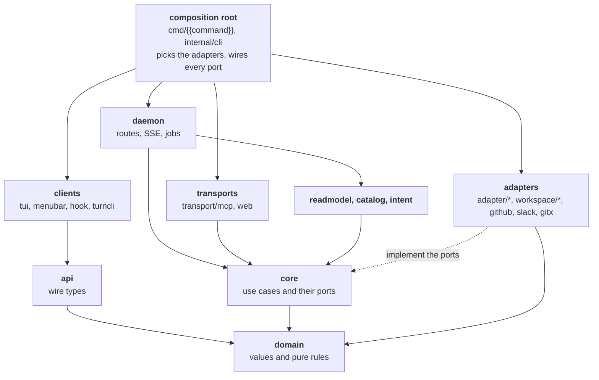

{{name}} is one Go module laid out as ports and adapters. The use cases and the values they work on know nothing of SQLite, GitHub, Slack, Orca or the coding agent; each outside tool is an adapter behind a small port, and one composition root picks the adapters. The rules below are tests in `internal/archtest`; [Testing](/architecture/testing/#the-architecture-tests) lists each one.

## The layers

Dependencies point down and inward. An adapter imports the port it implements and the domain; the core imports the domain and its own ports; the domain imports only the standard library.

| Layer | Packages | May import |
|---|---|---|
| Domain | `internal/domain/...` | the standard library and the domain; no adapter, manager or `internal/github` |
| Core | `internal/core/...` | the standard library, the core, the domain and `internal/meter`; never `os/exec`, `net/http` or `database/sql` |
| API | `internal/api` | the domain |
| Clients | `internal/client/...` | `internal/api`, `internal/api/client`, the domain and `internal/termfmt` |
| Read model | `internal/readmodel`, `internal/readmodel/cards` | ports; no adapter, GitHub, brief queue, situation deriver or Orca client |
| Daemon | `internal/daemon` | anything but the adapters, `internal/github` and the Orca client, which it reaches through ports `serve.go` wires |
| Adapters | `internal/adapter/...`, `internal/workspace/...`, `internal/github`, `internal/ghcli`, `internal/slack`, `internal/gitx` | the ports they implement and the domain |
| Composition root | `internal/cli`, `cmd/{{command}}` | everything |

Some packages sit beside the layers with rules of their own:

- **The intent vocabulary**: `internal/intent` (the loader), `internal/intent/builtin` (the names Go provides), `internal/intent/expr` (the predicate compiler, the only importer of cel-go), `internal/frontmatter`, `internal/catalog` (the actions a row offers). Each imports a fixed set; the loader never reaches the core, the daemon or an adapter, and only the catalog builds action specs or evaluates an intent's predicates.
- **Shared leaves**: `internal/brand` (every user-visible name), `internal/meter` (the cost of each boundary call, standard library only), `internal/procgroup` (the process group of each agent call the daemon runs, stopped on cancel and on the daemon's stop), `internal/termfmt`, `internal/keys`, `internal/config`.
- **Outside the core for now**: `internal/brief` runs its agent only through `turns.Asker` and reads the store only through the inventory; `internal/profile` composes the review profile's blocks; `internal/turn` renders a turn's instructions.

## Ports

A port is an interface declared by the core package that uses it, with at most five methods. A capability only some adapters offer is a second, optional interface the core finds by type assertion and does without, such as `turns.Questions` beside `turns.Agent`, or `workspace.Board` and `workspace.Waker` beside `workspace.Manager`. Types several core packages share, such as `Clock`, `Changes`, `Source` and `Effects`, live in `internal/core/port`. [Ports and adapters](/architecture/ports/) lists them.

## The composition root

`internal/cli` builds the binary's commands, and three of its files choose what runs:

- `root.go` holds the registries of agents and workspace managers: one entry per agent kind and per manager, the only place outside the adapters that names one;
- `sources.go` lists the compiled-in plugins, the only file that names a source (`slack*.go` wire the Slack source's commands);
- `storecmd.go` opens the store for the daemon, migrating it when it is older, and `serve.go` wires every port of the daemon.

The commands call the daemon through `internal/api/client`. Those that work with the daemon down, such as `install`, the stateless checks of `doctor` and the developer tools, run in the command's own process and never write the store.

## Where a change goes

| To add | Put it in | Then |
|---|---|---|
| A behavior: when something happens, on which units, with which text | the profile: a workflow under `profiles/default/workflows/<name>/` or an intent under `profiles/default/intents/<name>/` | see [Profile first](/architecture/profile-first/) |
| A fact a predicate reads | `builtin.Facts` in `internal/intent/builtin/facts.go`, computed by the provider's facts adapter (`internal/adapter/facts/<provider>`) | `make docs-ref` |
| A workflow step or an intent builtin | its name in `internal/intent/builtin/builtin.go`, its implementation in `internal/cli/steps.go` or `internal/cli/builtins.go` (`internal/daemon/builtins.go` for the daemon's routes) | `make docs-ref` |
| A use case | a package under `internal/core`, with the ports it needs declared there and a fake in `<name>test` | |
| A value or a pure rule | `internal/domain/<name>` | |
| An outside tool | an adapter under `internal/adapter/<tool>` implementing the core's port, plus one entry in `internal/cli/root.go` | |
| A source of units | a plugin: see [Plugins](/architecture/plugins/) | |
| An API route | its path in `internal/api`, its handler in `internal/daemon`, its call in `internal/api/client` | |
| A CLI command | `internal/cli`, calling the daemon through `internal/api/client` | `make docs-ref` |
| A view in the cockpit, the terminal or the menu bar | served by the daemon as data (rows, actions, facets, counters) and rendered by `internal/web/static`, `internal/client/tui` or `internal/client/menubar`; a plugin's own view through its `Module.UI` | |
| A store table or query | `internal/adapter/store/sqlite/schema.sql` with a migration to the next schema version, and a store method there; SQL text lives nowhere else | see [Changing the store's schema](/architecture/development/#changing-the-stores-schema) |
| A user-visible name | derived from `internal/brand` | |
